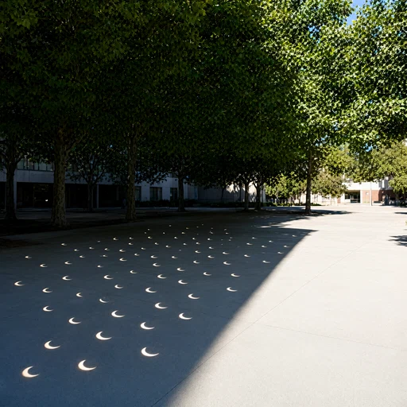

# OptiAtlas

**Optical reasoning for image generation.** A benchmark, traceable training data,
and an agent that turns scene requests into physically informed drawing prompts.

**Private migration preview.** Repositories and page sources remain private; the
project website has not been deployed. No paper acceptance or public release is implied.

[Dataset](https://huggingface.co/datasets/hopeymir/OptiAtlas) ·
[Policy + Generator](https://huggingface.co/hopeymir/OptiAtlas-Agent) ·
[Core migration archive](https://huggingface.co/datasets/hopeymir/CVPR2027) ·
[Local project page](site/index.html)



## What is included

- **OptiAtlas-Bench / Light-Omni-v6.1:** 457 scene requests, 1,002 questions,
  37 optical categories, with shuffled answer positions and preserved semantic mapping.
- **Training:** 13,867 original Dense pairs and 13,866 agent-conditioned pairs;
  frozen SFT trajectories and a 4,000-request RL pool with its original split.
- **Final system:** three-epoch SFT → continuous text-reward GRPO (RL95) →
  agent-pair generator adaptation with equal-weight group-normalized OPSD.
- **Ablations:** training stages, policy rewards, generator algorithms/rewards,
  and the strict same-image Dense/Agent caption control. Historical and controlled
  caption comparisons are labeled separately.

The final checkpoint is the historical **80.54%** main-table combination,
generator state `9ecae447a4c580742d1f33465ec6596a6a5d16eacaca77936905043e1580796f`.
It is not the later strict caption-control generator.

## Recorded benchmark results

All three columns below are **question-level percentages**. Semantic labels:
A = correct, B = incorrect, C = cannot determine.

- Precision: A / (A+B)
- Judgability: (A+B) / (A+B+C)
- Overall pass rate: A / (A+B+C)

| Model / method | Precision ↑ (%) | Judgability (%) | Overall pass (%) |
|---|---:|---:|---:|
| Nano Banana 2.1 | 86.50 | 98.30 | 85.03 |
| OptiAtlas-Agent | 80.54 | 99.00 | 79.74 |
| Seedream 5.0 Pro | 75.76 | 98.80 | 74.85 |
| Qwen-Image 3.0 | 57.51 | 97.70 | 56.19 |
| FLUX.2-dev | 53.96 | 98.20 | 52.99 |
| Qwen-Image-2.1 | 53.94 | 97.50 | 52.59 |
| SenseNova-U1.5 | 52.90 | 98.10 | 51.90 |
| Grok-2-image | 52.70 | 98.10 | 51.70 |
| HunyuanImage 3.0 | 45.73 | 98.20 | 44.91 |
| Z-Image Turbo | 41.24 | 96.31 | 39.72 |

This is the selected single-run comparison under the Gemini-3.6-Flash judge.
The final system's three recorded generation runs are **80.54 / 79.43 / 78.08%**
Precision (mean from raw counts **79.35256%**, sample SD **1.23220 percentage points**).
Single-run improvements must not be described as the repeated mean or as proof
that Agent captions beat the strict Dense-caption control. Aggregate source counts
are provided in [site/results.json](site/results.json); bulk experimental outputs
remain in the private archive.

## Start here

Use the environment and CLI documentation in this repository. Configure paths to
the dataset and model snapshots locally; credentials are supplied through environment
variables, never source files. CLI commands default to planning until `--execute`.

```bash
python -m optiatlas --help
```

Load the supplied **SFT-merged policy base + RL95 adapter exactly once**. The image
generator uses the fixed upstream Qwen-Image-2.1 revision and the final generator
adapter. Preserve the release's FP32 LoRA master loading and scaling. Do not use
raw Qwen3.8-27B plus RL95 alone.

The independent project page opens from `site/index.html` with no external scripts,
build step or hosted analytics. It contains selected examples, not the full dataset.

## Reproducibility and scope

The source export contains the final method and its four ablation families, rather
than the historical cluster job menu. Original weights/data and environment archives
are not embedded in Git. Version pins and original-config provenance are recorded;
current reconstructed deployment code is not claimed byte-identical to the old RL
run. A100 runtime validation remains pending. Existing upstream and data-specific
licenses apply; a public-release licensing decision is still required.
